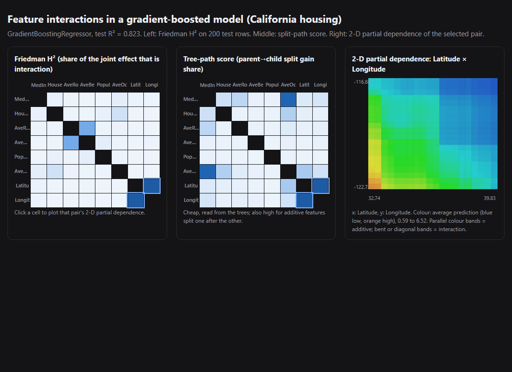

# tree-interactions

 

**Which features interact inside a tree ensemble, and can you trust the answer?**

Two ways to measure pairwise feature interactions in gradient boosting and random forests, both implemented from scratch on top of scikit-learn:

- **Friedman's H-statistic** (`src/treeint/hstat.py`): the share of the joint partial dependence of features *j, k* that is not explained by their separate effects. Model-agnostic, but it needs n² predictions per pair.
- **Tree-path scores** (`src/treeint/paths.py`): read the trees directly and add up the gain of every split on *k* made right below a split on *j*. No predictions at all, so it is about 200× faster. I also tried a "lift" version normalised by how often each feature is split anyway.

They are scored on **synthetic data with planted interactions** (so the right answer is known), then applied to California housing with an **interactive HTML report** (heatmaps; click a pair to see its 2-D partial dependence).



## Results: planted interactions (5 seeds × 2 models × 4 scenarios)

8 features with strong additive effects on all of them, plus planted interactions. *Recall* = share of planted pairs ranked in the top *k* (k = number of planted pairs). *Best wrong pair* = highest score given to a pair that does not interact.

| Scenario | Model | H-statistic recall | H best wrong pair | Tree paths recall | Paths, lift recall |
|---|---|---|---|---|---|
| one product pair (2·x0·x1) | boosting | **1.0** | 0.003 | 1.0 | 0.4 |
| | forest | **1.0** | 0.007 | 0.4 | 0.6 |
| one threshold pair | boosting | **1.0** | 0.003 | 0.0 | 0.6 |
| | forest | **1.0** | 0.005 | 0.0 | 0.4 |
| two pairs (sine + product) | boosting | **1.0** | 0.004 | 1.0 | 0.9 |
| | forest | **1.0** | 0.006 | 0.7 | 0.6 |
| no interaction at all | boosting | n/a | **0.002** | n/a (best wrong 0.17) | n/a |
| | forest | n/a | **0.007** | n/a (best wrong 0.20) | n/a |

What the numbers say:

1. **The H-statistic found every planted pair (30/30 runs with interactions) and stayed near 0 when there was nothing to find.** Its scale is meaningful: an H² of 0.2 is a real interaction, 0.005 is noise.
2. **Tree-path counting confuses "split one after the other" with "interact".** A depth-3 tree that needs x2 and x5 additively still splits x5 below x2, so additive pairs score as high as real ones: on a model with no interaction at all, its top pair still gets 0.17 to 0.20. It failed completely on the threshold interaction.
3. **Normalising by split frequency (lift) did not fix it** (recall 0.4 to 0.9), so the cheap structural score is a hint for where to look, not an answer. The cost gap is real though: about 1.5 s per model for H (n = 120 rows) vs under 0.1 s for paths.

Full table: `results/benchmark_summary.md`.

## Case study: California housing

Gradient boosting, test R² = 0.823 (`results/california_summary.md`, `results/california_interactions.html`).

| Pair | H² | Path score |
|---|---|---|
| **Latitude × Longitude** | **0.677** | **0.285** |
| AveRooms × AveBedrms | 0.327 | 0.005 |
| HouseAge × AveOccup | 0.086 | 0.069 |
| MedInc × AveOccup | 0.030 | 0.268 |

- Both methods agree on the expected one: price depends on *location*, which neither coordinate gives alone (the 2-D plot shows the coastal bands).
- They disagree on the next ones, and both disagreements need care. **AveRooms × AveBedrms** has a high H² but is a known weakness of partial dependence: the two are strongly correlated, so H evaluates impossible houses (many rooms, almost no bedrooms). **MedInc × AveOccup** has a high path score but a low H²: the trees split them one after the other, which (see above) is not evidence of interaction.

## Run it

```bash
pip install numpy pandas scikit-learn pytest
pytest -q
python scripts/run_all.py      # about 3 minutes; writes results/
```

## Licence

MIT
